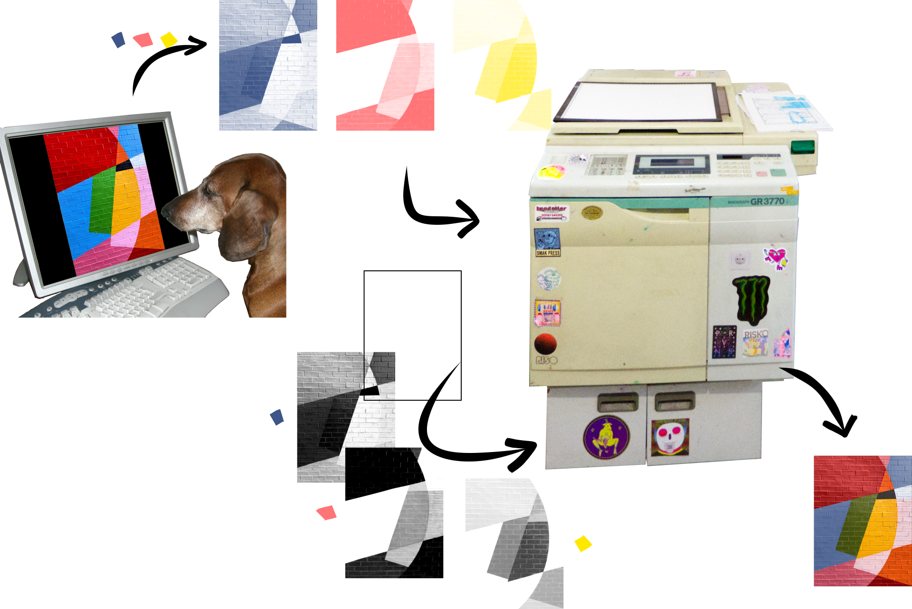
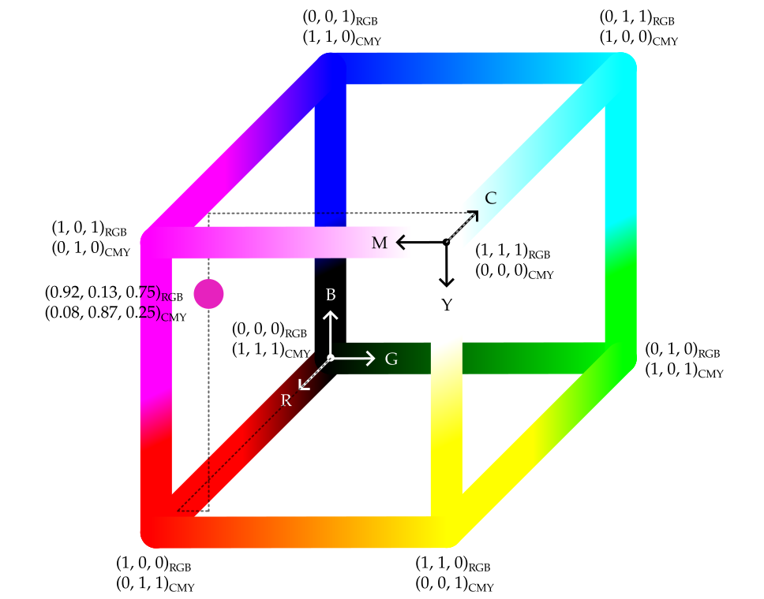
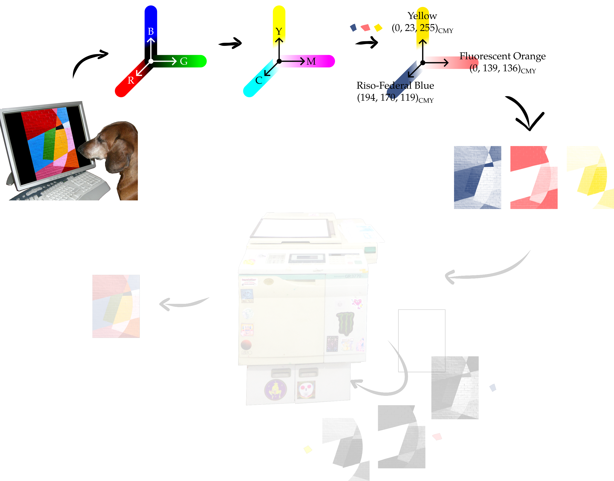

# RISO.jl

RISO.jl is a Julia package that provides minimal tools for the **preparation of Risograph prints**. RISO.jl works with the simplifying assumption that colors form a [vector space](https://en.wikipedia.org/wiki/Vector_space). Then, it implements a color separation algorithm based on a [change of basis](https://en.wikipedia.org/wiki/Change_of_basis) within this vector space. The chain of [arguments](#how-does-risojl-work) on which RISO.jl rests does not intend to be accurate from a [color theory](https://en.wikipedia.org/wiki/Color_theory) perspective. Yet, the approach works quite well in practice. It is worth highlighting that, even with perfectly separated colors, each final RISO print carries unique imperfections inherent to the printing technique, and RISO artists often appreciate that.

## RISO printing

[_Risograph_](https://en.wikipedia.org/wiki/Risograph) printers, also called _RISO_ printers, are a type of digital duplication and printing device. They were initially conceived for efficient high-volume photocopying and printing, but artists are choosing them also for the unique imperfections inherent to the printing technique, as well as for the characteristic colors achieved.

The RISO printing process works roughly as follows ([Figure 1](#fig-workflow)). Suppose that a RISO artist wants to print 500 copies of a piece of work, which we will call the _artwork_. The artist chooses a palette of a few base colors. These are actual [color cylinders](https://www.riso.co.jp/english/product/digital_dup/consumables/index.html), usually called _drums_, that the Risograph device will use for this set of prints. Suppose the artist settles for three colors: [Riso-Federal Blue](https://stencil.wiki/wiki/Riso-Federal_Blue), [Fluorescent Orange](https://stencil.wiki/wiki/Fluorescent_Orange) and [Yellow](https://stencil.wiki/wiki/Yellow).

Usual color printers reproduce the color in each pixel of the artwork by mixing cyan, magenta, yellow and black as instructed by some rule, usually not transparent to the artist. In RISO printing, it is the artist's responsibility to provide a decomposition of the artwork suitable for printing using the chosen palette. This operation is informally called _preparing the prints_ or _separating the colors_.

To prepare the prints, the artist needs to find a way to separate the original color image into three grayscale images, one for Riso-Federal Blue, one for Fluorescent Orange and one for Yellow, such that the overlay of the three grayscale images, each printed using its color, reproduces the original artwork. This is literally so. The RISO printer typically has one drum loaded at a time. The artist loads 500 blank pages on the printer tray, loads the Riso-Federal Blue drum, and makes 500 copies of that layer. The process is then repeated with Fluorescent Orange, but this time on top of the already printed pages. Same at the end with Yellow.

<figure>
    <a name="fig-workflow"></a>
    
    <figcaption>
        Figure 1. The RISO printing workflow.<br>
        <i>
            Artwork credit:
            <a href="https://www.flickr.com/photos/konradfoerstner/4634880593">Dog at computer</a>
            by Konrad Förstner on Flickr
            (<a href="https://creativecommons.org/licenses/by/2.0/">CC BY 2.0</a>), adapted.
            <a href="https://unsplash.com/photos/brick-wall-with-colorful-geometric-shapes-kgqu_qs3B78">Wall paint</a>
            by @fatihwashere on <a href="https://unsplash.com">Unsplash</a>.
            GR3770 printer by <a href="https://potatopublishing.at">Potato Publishing</a> (used with permission).
            Composite by Andreu Vall (All Rights Reserved, covering only the layout and additions).
        </i>
    </figcaption>
</figure>

## How does RISO.jl work

Here we will adopt the following terminology, with both definitions borrowed from Wikipedia:

> A [color space](https://en.wikipedia.org/wiki/Color_space) is a specific organization of colors. In combination with color profiling supported by various physical devices, it supports reproducible representations of color. (example: [sRGB](https://en.wikipedia.org/wiki/SRGB))

> [A color model](https://en.wikipedia.org/wiki/Color_model) is an abstract mathematical model describing the way colors can be represented as tuples of numbers, typically as three or four values or color components. It differs from a color space in that a color model is not absolute, that is, there is no way to map a color within a color model to a point in a color space. (example: [RGB](https://en.wikipedia.org/wiki/RGB_color_model))

RISO.jl works on the latter and in a very restricted way:

**Input:**
- the input image in the RGB color model,
- a target palette (the drums that the RISO artist wants to use) expressed in the RGB color model.

**Output:**
- as many grayscale images as colors in the palette.

RISO.jl further makes an important assumption. It accepts the [CMY](https://en.wikipedia.org/wiki/CMYK_color_model#Comparison_to_CMY) color model ([subtractive](https://en.wikipedia.org/wiki/Subtractive_color)) as the "opposite" of RGB ([additive](https://en.wikipedia.org/wiki/Additive_color)). Indeed, the first thing RISO.jl does is converting the input image and the target palette from RGB into CMY. The reason for that is that the goal is to prepare prints, and prints are on paper. It is crucial to have white as the origin of the color model.

> [!NOTE]
> **The RGB-CMY cube:** We accept that colors in the RGB color model can be expressed using fractional values. That is, $`(255, 0, 0)_{\text{RGB}}`$ and $`(1, 0, 0)_{\text{RGB}}`$ are equivalent representations for red. Now, accepting CMY to be the "opposite" of RGB means accepting that an arbitrary color in RGB fractional coordinates $`(x, y, z)_{\text{RGB}}`$ can be expressed equivalently in the CMY coordinates $`(1 - x, 1 - y, 1 - z)_{\text{CMY}}`$.
>
> <figure>
>    <a name="fig-rgb-and-cmy"></a>
>    
>    <br>
>    <figcaption>
>        <i>Artwork credit: RGB-CMY cube by Andreu Vall (<a href="https://creativecommons.org/licenses/by-nc-sa/4.0/">CC BY-NC-SA 4.0</a>)</i>
>    </figcaption>
> </figure>

Under the assumption that colors can be thought of as vector spaces, the target palette converted into CMY can be understood as a change-of-basis matrix. Then, RISO.jl approximates the coordinates of the input image in terms of the target palette.

Let's revisit RISO.jl's approach again alongside the example of our RISO artist ([Figure 2](#fig-separation)). The RISO artist wants to print 500 copies of an artwork. The artwork is a digital image represented in the RGB color model. RISO.jl goes ahead and re-expresses the artwork in CMY, just by the direct calculation that follows from assuming that CMY is the "opposite" of RGB. That is, for each pixel in the artwork,

$$(x, y, z)_{\text{RGB}} \to (1 - x, 1 - y, 1 - z)_{\text{CMY}}.$$

The artist chooses a palette of a few base colors, the actual _drums_ that the Risograph device will use. Suppose these are Riso-Federal Blue, Fluorescent Orange and Yellow. Thus, the artist provides RISO.jl with the RGB representations of the three palette colors:

- Riso-Federal Blue: $(61, 85, 136)_{\text{RGB}}$,
- Fluorescent Orange: $(255, 116, 119)_{\text{RGB}}$,
- Yellow: $(255, 232, 0)_{\text{RGB}}$.

Again, RISO.jl goes on and re-expresses these three colors in CMY:

- Riso-Federal Blue: $(194, 170, 119)_{\text{CMY}}$,
- Fluorescent Orange: $(0, 139, 136)_{\text{CMY}}$,
- Yellow: $(0, 23, 255)_{\text{CMY}}$.

> [!NOTE]
> **Fractional:** CMY colors are never expressed using integer components. Here, we did so just for simplicity. To be exact, if $`(x, y, z)_{\text{RGB}}`$ use integer components, we first make them fractional, $`(\frac{x}{255}, \frac{y}{255}, \frac{z}{255})_{\text{RGB}}`$, and only then convert them to $`(1 - \frac{x}{255}, 1 - \frac{y}{255}, 1 - \frac{z}{255})_{\text{CMY}} = (\frac{255 - x}{255}, \frac{255 - y}{255}, \frac{255 - z}{255})_{\text{CMY}}`$. The numerators in the last expression are the integers we wrote above to concisely express the palette in the CMY color model.

Now, RISO.jl has the input image and the target palette expressed in CMY. Importantly, the latter can be understood as a change-of-basis matrix. That is, a matrix containing the coordinates of the target basis vectors (the palette) expressed using the source basis (CMY). With it, RISO.jl approximates the coordinates of the input image in terms of the target palette, and stores them into three grayscale images, one for each color in the target palette. RISO.jl's job is done, and the artist can move on to printing.

<figure>
    <a name="fig-separation"></a>
    
    <figcaption>
        Figure 2. Color separation with RISO.jl. The steps in the grayed-out area belong to the RISO printing workflow, but RISO.jl does not address them.<br>
        <i>
            Artwork credit:
            <a href="https://www.flickr.com/photos/konradfoerstner/4634880593">Dog at computer</a>
            by Konrad Förstner on Flickr
            (<a href="https://creativecommons.org/licenses/by/2.0/">CC BY 2.0</a>), adapted.
            <a href="https://unsplash.com/photos/brick-wall-with-colorful-geometric-shapes-kgqu_qs3B78">Wall paint</a>
            by @fatihwashere on <a href="https://unsplash.com">Unsplash</a>.
            GR3770 printer by <a href="https://potatopublishing.at">Potato Publishing</a> (used with permission).
            Composite by Andreu Vall (All Rights Reserved, covering only the layout and additions).
        </i>
    </figcaption>
</figure>

## Usage

The process described above reads a bit idealized. RISO.jl does not actually automate the process. RISO.jl is a Julia package that implements tools for preparing RISO prints, and users are free to experiment with these tools.

> [!WARNING]
> RISO.jl is not registered yet. It relies on [Colors.jl](https://github.com/JuliaGraphics/Colors.jl), [ColorTypes.jl](https://github.com/JuliaGraphics/ColorTypes.jl) and [ColorVectorSpace.jl](https://github.com/JuliaGraphics/ColorVectorSpace.jl), but with the changes filed in PRs [#574](https://github.com/JuliaGraphics/Colors.jl/pull/574), [#326](https://github.com/JuliaGraphics/ColorTypes.jl/pull/326) and [#198](https://github.com/JuliaGraphics/ColorVectorSpace.jl/pull/198), respectively, which are still drafts. It is unclear how RISO.jl will end up getting the tools it needs. In the meantime, adding RISO.jl to another project with `Pkg.add` will not work.

The `Project.toml` of this repository points to the changes from the PRs above, so cloning it is the way to try RISO.jl for now. The setup requires [Julia](https://julialang.org/) 1.11 or later.

### Setup (only once)

In a terminal, clone the repository, navigate into the directory and start Julia with the dedicated environment:

```bash
git clone https://github.com/andreuvall/RISO.jl
cd RISO.jl
julia --project=.
```

Once in the Julia REPL, instantiate the project:

```julia
using Pkg
Pkg.instantiate()
```

This installs the dependencies. The first run of `Pkg.instantiate()` downloads and precompiles several packages, so it can take a few minutes. Afterwards, the Julia environment is set up and ready to be used.

### Starting Julia later

The environment stays set up. In a new terminal, navigate into the project directory and start Julia with the same environment:

```bash
cd RISO.jl
julia --project=.
```

### Example

With the Julia environment set up and the Julia REPL started, the process described above could look like this:

```julia
# load the required packages
using Images
using Colors
using ColorTypes
using ColorVectorSpace
using RISO

# load the input image in RGB
# (this path works when run from the repository root)
image_rgb = load("test/wcmyk-squares-rgb8.png")

# specify the target palette in RGB
p_rgb = Palette([
        RGB( 61/255,  85/255, 136/255),     # Riso-Federal Blue
        RGB(255/255, 116/255, 119/255),     # Fluorescent Orange
        RGB(255/255, 232/255,   0/255)      # Yellow
    ]
)
preview(p_rgb)

# express the image as fractional and convert it to CMY
# dot-broadcasting works because `image_rgb` is an array
image = (CMY ∘ float).(image_rgb)

# express the palette as fractional and convert it to CMY
# map, don't dot-broadcast, because `Palette` is not an `AbstractArray`
p = map(CMY ∘ float, p_rgb)

# re-express the image in the target palette
transformed = transform(image, p)
preview(transformed, p)

# save the grayscale images
save("./result", transformed, p)
```

## A personal note

Many RISO artists rely on the [Spectrolite](https://spectrolite.app) software to prepare their prints. Spectrolite has many features and it is [free of cost](https://spectrolite.app/how-to/resources/about/free), but it is not open-source software. Also, when I started this project, Spectrolite was only available for Mac (since April 2026 it is also available for Windows).

I am not a RISO artist myself, but I am close to RISO artists. Their openness and willingness to share knowledge and skills with others motivated me to start this project. When I first learned about RISO printing, I wondered how separating color into arbitrary color components could work. RISO.jl proposes a very specific way to do so, and does only that. RISO.jl is an open-source prototype for RISO artists to try out and explore.

While working on this, I have only become more aware of the complexity of color, and of color and digital devices such as computers and printers. RISO.jl is not pretending to be right or accurate. On the contrary, it plays along with the love for imperfection that RISO artists also appreciate. RISO.jl does not know about the absolute representation of color or about color profiles. It just approximates how colors can be expressed in arbitrary palettes.

Finally, I want to acknowledge the help and support received from the following initiatives and collectives:

- [d*sign week 2023, Perspectives on Selfpublishing](https://dsignweek.servus.at/2023)
- [d*sign week 2025, For who(m) is the making?](https://core.servus.at/de/content/dsign-week-2025)
- [Potato Publishing](https://potatopublishing.at)

## Licensing

This project uses a split-licensing model:

* **Source code and tests:** licensed under the **GNU Affero General Public License v3.0 or later (AGPL-3.0-or-later)**. See [LICENSE](./LICENSE).
* **Artwork:** the images in the `/artwork` directory are **not** covered by the software license. They are either original work ([CC BY-NC-SA 4.0](https://creativecommons.org/licenses/by-nc-sa/4.0/)) or composites (All Rights Reserved) that include third-party material under its own license.

For full details and attributions, see [LICENSING.md](./LICENSING.md) and the [artwork manifest](./artwork/Artwork.toml).